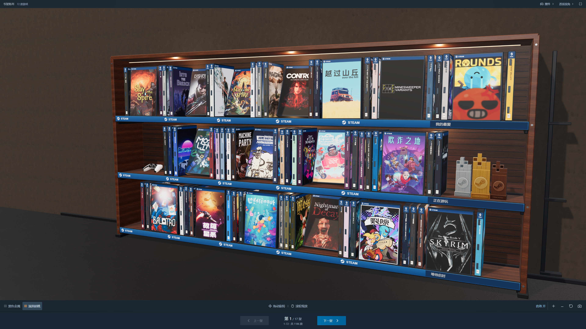
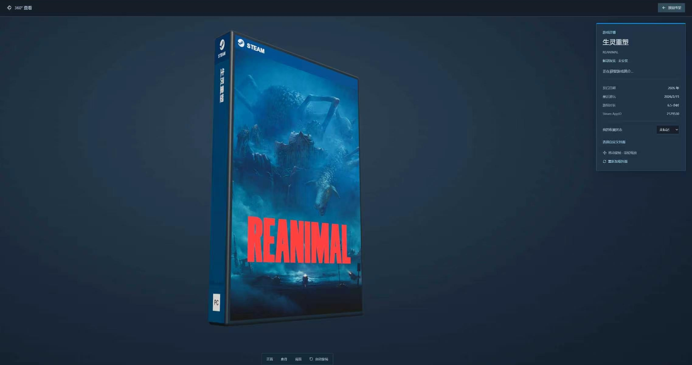

# Steam Shelf

把 Steam 游戏库变成可交互的 3D 游戏书架。支持已安装与未安装游戏、中英文切换、自由布置和 360° 查看。Windows 独立应用，使用 Electron、React 和 Three.js，默认胡桃木材质，也可切换黑色金属。

An interactive 3D shelf for your Steam library, including uninstalled games. Features Chinese / English interfaces, customizable arrangements, and 360° inspection of game cases and collectibles.

[下载 Windows 便携版 / Download for Windows](https://github.com/Aussice/Steam-Shelf/releases/latest) · [素材与署名 / Credits](public/credits.txt) · [开发与构建](#开发)

## 实机截图 / Screenshots

### 3D 游戏书架 / Your library on a shelf



### 360° 查看 / Inspect every side



以上为 App 实际截图。游戏封面和标识归各自权利人所有。

## 0.8.0 更新

- 顶部新增「中文 / EN」切换，立即切换并记住选择；首次使用按系统语言选择中文或英文。
- 主界面、菜单、收藏状态、布置面板、游戏和摆件 360° 查看、帮助、导入导出及操作提示均支持中英双语。
- Steam 简介按当前语言读取，两种语言分别缓存；英文模式优先显示已有英文游戏名称，原始封面与用户自定义内容保持原样。
- 英文长文案支持工具栏换行和分类自适应；原有收藏、排序和安装状态无需重新导入。
- Windows 新版：`release/0.8.0/Steam Shelf.exe`。

## 0.7.1 更新

- 修正「书架顺序」和收藏状态菜单：统一 App 内深色弹层、蓝色勾选与悬停状态，支持方向键、Enter、Esc 和外部点击关闭。
- 弹层独立于 3D 场景显示，靠近窗口边缘时自动调整位置，避免裁切和遮挡。

## 0.7 更新

- PS5 DualSense 改为按键朝上的平躺姿态，缩小为 0.6 版的一半，外壳底部落在层板上；三座奖杯缩小 25% 并收紧间距，底座贴住层板；手柄及金银铜奖杯均可点击进入独立 360° 查看。
- 默认使用胡桃木材质，首次升级迁移到新默认，之后记住手动选择。底部拖动、缩放、音效和材质工具使用与其他控件一致的 13px 字号与 36px 高度。
- 重做 Steam 客户端风格的界面：深蓝灰底色、紧凑侧栏、蓝色选中态、统一的直角按钮和更清晰的字号。
- 上方放游戏库导航，搜索、状态和排序集中在书架上方；书架随窗口填满剩余空间，翻页固定在正下方。
- 游戏抽取面板、360° 详情、书架布置、游戏库管理、空状态和提示框使用统一样式。
- 保留游戏库读取、未安装筛选、自定义封面、收藏与陈列偏好；侧栏桌面默认展开，小屏默认折叠。

## 0.6 更新

- 删除泰迪熊，旧手柄换成 Taohid Animation 的现成 PS5 DualSense，保留金银铜 Steam 奖杯；模型作者与 CC BY 4.0 授权已放入帮助和随附 credits.txt。
- 盒顶、架前条和奖杯使用 Valve 官方 Steam SVG 的原始轮廓，修正简化画法。
- 层架深度由 3.18 收到 1.92，刚好容纳侧立游戏盒；约四成正面盒倾斜靠住后板，其余保持靠前直立展示，每盒底部均落在层板表面。
- 增加简约书架应用图标，包括多尺寸 Windows ICO、窗口与网页图标；应用名称统一为 Steam Shelf。

## 0.5.1 更新

- 主机换成现成的坐姿泰迪熊，保留手柄点缀，摆件均为本地素材。
- Steam 奖杯按参考图重做为金、银、铜像素阶梯立柱，加入凹格、连接杆浮雕、拉丝金属和底座铭文。
- 正面陈列一个位置只放一个游戏盒，取消后排盖住另一张封面的摆法；游戏盒脊仍在相邻位置成组陈列。所有游戏仍各保留一盒，手动指定的摆放方式继续有效。

## 0.5 更新

- 侧栏默认展开，抽盒 / 放回音效默认开启；音效仍可关闭，保存后会记住你的选择。
- 黑色金属与胡桃木层架、墙壁、地面使用随程序打包的实拍 PBR 贴图，增加细纹、粗糙度变化与磨损。
- 加入现成主机、手柄和金银收藏奖杯，在层架留白处点缀；空间不足时移至架顶。模型本地载入，来源与 CC0 许可见 [模型素材说明](docs/MODEL-ASSETS.md) 和 [材质素材说明](docs/MATERIAL-ASSETS.md)。
- 翻页移到书架正下方，放大「上一架 / 下一架」，同时显示页码和当前游戏范围；全屏仍可翻页。

## 0.4 更新

- 深夜收藏室：冷色房间环境、暖色层架灯带、墙面和地面、落地阴影、相邻架体线索；保留清晰、低反光的游戏封面。
- 更自然的疏密陈列，盒脊颜色从封面提取；加入真实游戏盒横放堆叠和手柄装饰。没有用重复游戏填充。
- 「布置书架」模式可拖动游戏盒交换位置，或通过按钮调整顺序；可指定封面朝前、盒脊朝前及横放。层架标签支持编辑，位置与镜头会自动保存，也可恢复自然陈列。
- 收藏进度：待玩、在玩、已通关、特别喜欢，可手动标记并筛选；与爱心收藏独立保存。
- 支持 JPG、PNG、WebP 自定义封面（原图小于12 MB），可恢复官方封面。图片保存在本机，不上传。
- 360°查看增加真实商店简介、发行日期、开发者及本机最近游玩时间；生成的盒背同步显示资料。商店资料按需读取，并缓存以便离线使用。
- 两段式抽盒 / 放回动作；可开启轻微摩擦与落位音效，默认关闭。
- 新版收藏备份同时保存摆放、标签、收藏进度、镜头、材质、音效和自定义封面，仍兼容旧版清单。启动后台刷新不会清空正在输入的搜索。

## 0.3 更新

- 封面读取支持 Steam 新版带版本路径的 `library_capsule_2x` 素材，增加图片有效性检查、并发控制、磁盘缓存和失败重试。缺少竖版时使用真实商店横图排版。
- 单击游戏盒出列，选择「放回」或「360° 查看」；支持自由拖动、自动旋转和正面 / 盒脊 / 背面切换，悬浮信息显示名称、类型、安装状态和游玩时长。盒背根据基本信息生成。
- 默认收起侧栏，压缩工具区域，三层宽书架充满主要展示区；每架仍展示72款。
- 减弱封面清漆和薄膜反光，提高渲染分辨率与远景贴图清晰度。

## 0.2 更新

- 黑金属深层架，正面展示、成组侧立和后排混合；可以看到其他游戏盒的盒脊、盒顶和前后遮挡。每个真实游戏只建一个模型。
- 改善塑料盒接缝、铰链、清漆和透明膜反射，增加环境反射与接触阴影；更高渲染分辨率，镜头自动贴合书架。每架72款，可以主动拉近查看。
- 通过运行中的 Steam 客户端核对当前账号的游戏归属，读取已安装与未安装游戏，无需 API Key。当前电脑实测 1186 款，其中已安装73、未安装1113。
- 左栏增加未安装筛选；本地浏览器预览也能显示同一游戏库和缓存封面。

## 直接使用

从 [Releases](https://github.com/Aussice/Steam-Shelf/releases/latest) 下载 `Steam Shelf.exe` 后直接打开。这是 Windows x64 便携应用，不需要安装开发工具。自行构建的文件位于 `release/0.8.0/Steam Shelf.exe`。

打开并登录 Steam，启动书架后自动读取当前账号库。`appinfo.vdf` 提供游戏资料，ISteamApps 本机只读接口核对归属，`libraryfolders.vdf` 和安装清单提供安装状态；同时包含未安装游戏。已有收藏会保留，刷新时点右上角「管理游戏库」。扫描仅读取配置和已安装游戏的清单，不会修改 Steam 文件。

自行构建后，如果便携版无法启动，也可打开 `release/0.8.0/win-unpacked/Steam Shelf.exe`，请保留同目录下的全部文件。当前版本未做代码签名。

## 连接自己的游戏

- **自动读取：** Steam 处于运行且登录状态时，通过客户端读取已安装与未安装游戏，无需 Key。筛选游戏类型，排除运行库、工具和 DLC。安装状态仍读取多个 SteamLibrary 目录的完成标记。若客户端不可用则明确回退到已安装条目并提示原因。
- **完整已购游戏库：** 在「管理游戏库」展开 Steam API，填写 17 位 SteamID64 和 32 位 Web API Key。游戏详情需要对该请求可见。Key 仅经应用主进程发送至 `api.steampowered.com`，不存储、不写日志。
- **JSON 清单：** 导入本应用导出的备份、Steam `GetOwnedGames` 返回数据，或 `examples/collection-example.json` 格式的数组。也可直接把 JSON 文件拖入书架。

自动读取会核对 Steam 当前登录账号，避免把其他账号残留的游戏资料算进收藏。资料来自 Steam 本地缓存，新购买或刚切换账号的游戏可能需要先在 Steam 中打开游戏库刷新。未运行客户端时可以使用 API 或 JSON。在线 Web API 仍需 Key，本次无需它即已读到未安装游戏。

## 操作

- 左键拖动 / 单指拖动：旋转书架；滚轮 / 双指缩放：拉近或拉远。
- 单击盒子：抽出游戏，浮动卡片可选择放回或360°查看。在查看界面拖动即可旋转，顶部「放回书架」或 Esc 退出。
- 爱心：加入收藏。左栏可筛选收藏、安装状态及清单自带的类型。
- 搜索支持游戏名称、演示游戏中文名、AppID；`Ctrl K` 聚焦搜索。
- 书架每架展示 72 款，更多游戏通过正下方「上一架 / 下一架」翻架。
- 「布置书架」中拖动游戏盒交换位置，单击盒子设置摆放方向；侧面面板可以编辑三层标签。摆放更改会自动保存。「恢复自然陈列」保留标签和收藏进度。
- 收藏进度可在选中卡片或360°查看中设置，通过上方「全部进度」筛选。音效开关位于书架右下角。
- 360°查看中的「选择自定义封面」接受本机图片，可随时恢复官方封面。封面使用独立的本机图片存储，不占普通偏好设置空间。
- 「今天玩什么」随机选择当前筛选中的一款。
- 右上角切换平面视图，可键盘选择游戏。全屏、正面视角、视角重置、书架截图均可使用。
- 真实游戏通过 `steam://rungameid/APPID` 把启动请求交给 Steam。实际能否启动取决于 Steam 登录、所有权、游戏安装状态。演示游戏不会发起启动请求。
- 收藏清单可导出 JSON，包含收藏标记；导入备份可以恢复。

收藏和主题保存在应用的本地浏览器存储中，自定义封面保存在应用的 IndexedDB 中。真实游戏优先使用自定义和已有封面，再请求 Steam CDN；网络与缓存均不可用时显示标题封面，可点「重试缺失封面」或在360°查看中重新加载。应用封面缓存位于 `%LOCALAPPDATA%\Steam Shelf\artwork`，商店简介缓存在同级 `details` 文件夹。简介通过 Steam 商店公开资料接口按需请求，仅发送公开 AppID，不发送个人标记或自定义图片。24 款演示游戏封面随程序打包，可离线浏览。

## 开发

```powershell
npm ci
npm run dev
```

浏览器预览支持 3D、搜索、收藏、截图、JSON 导入导出；本机客户端读取和缓存封面也可由仅监听本机的预览服务提供；Steam Web API 连接由桌面应用提供。

```powershell
npm test
npm run build
npm run app
npm run pack
```

`pack` 生成 Windows x64 便携版及完整程序文件夹。构建使用 `node_modules/electron/dist` 中的 Electron 发行包；普通安装会自动准备它。本次因官方发行包下载端点不可达，使用本机已有的 Electron 43.1.0 官方发行缓存完成打包，版本锁定在锁文件中。

## 验证与边界

- 自动验证：Valve KeyValues 解析、Windows 路径转义、重复与无效 AppID 处理、多库扫描、未完成安装过滤、损坏配置容错、混合陈列与自定义摆放、个人备份校验、封面版本路径及商店资料纯文本处理。
- 浏览器检查：实际 3D 封面和阴影、鼠标选择、360°自由旋转、背面查看、放回、中文搜索、收藏切换、空结果处理、材质切换、平面视图、窄屏布局。
- 主进程仅暴露特定 IPC；校验调用来源和 AppID；渲染进程关闭 Node 集成，启用上下文隔离和沙箱；封面读取限定在 Steam 缓存及应用封面缓存目录。
- 本次不自动启动任何真实游戏，不修改 Steam 客户端，不处理 Steam 登录密码。
- 游戏盒与架体使用参数化几何；摆件使用现成模型（CC0 / CC BY 4.0），模型与实拍材质均随程序打包。奖杯是收藏装饰，不代表已获得特定 Steam 成就。
- 本机接口只执行创建/释放读取连接、检查游戏归属，不安装或改写 Steam，也不读取登录令牌。原生接口放在独立子进程中，出现错误会回退到已安装扫描。

这是个人使用的独立原型，非 Valve 官方插件。Steam 标识及游戏封面归相应权利人所有。

接口参考：[Steam IPlayerService](https://partner.steamgames.com/doc/webapi/IPlayerService)、[Electron 安全指南](https://www.electronjs.org/docs/latest/tutorial/security)、[Three.js OrbitControls](https://threejs.org/docs/pages/OrbitControls.html)。
